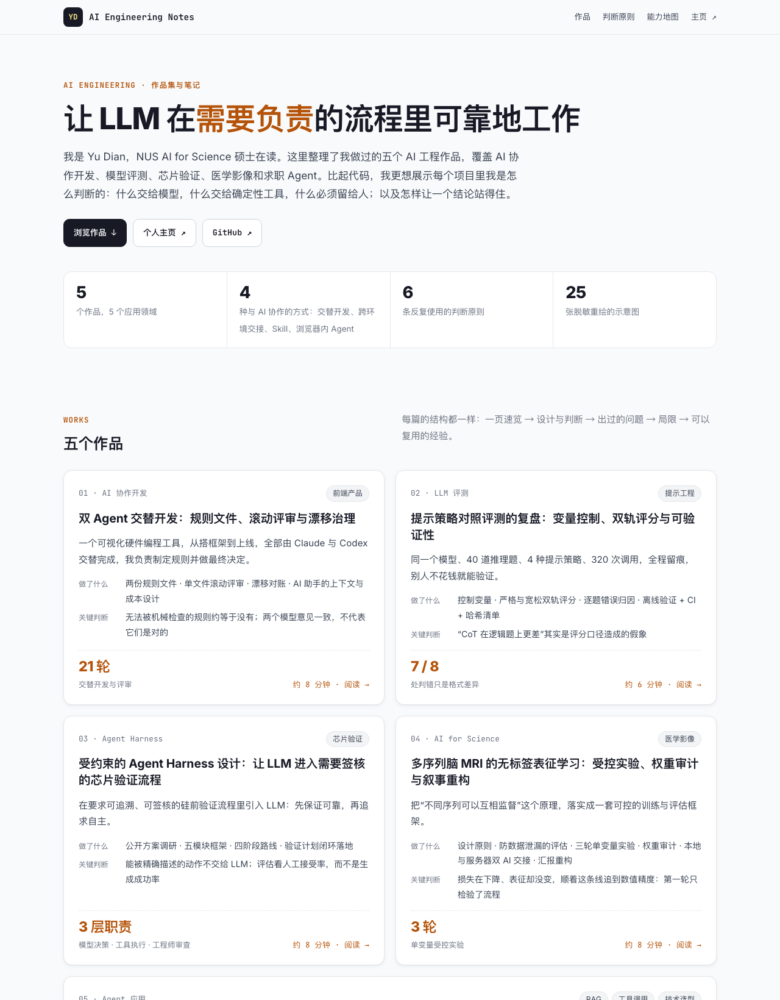

# AI Engineering Notes

**让 LLM 在需要负责的流程里可靠地工作。** 这里是 Yu Dian（NUS AI for Science）的 AI 工程作品集，也带一点分享：五个作品，重点讲设计判断，不讲代码。

**在线阅读 → [evelyn77yu.github.io/ai-engineering-blog](https://evelyn77yu.github.io/ai-engineering-blog/)** · [个人主页](https://evelyn77yu.github.io)

## 五个作品

| # | 作品 | 一句话 | 关键判断 |
|---|---|---|---|
| 01 | [双 Agent 交替开发：规则文件、滚动评审与漂移治理](https://evelyn77yu.github.io/ai-engineering-blog/posts/01-dual-agent-workflow.html) | 一个可视化硬件编程工具，由 Claude 与 Codex 交替开发了 21 轮 | 无法被机械检查的规则约等于没有；两个模型意见一致，不代表它们是对的 |
| 02 | [提示策略对照评测的复盘：变量控制、双轨评分与可验证性](https://evelyn77yu.github.io/ai-engineering-blog/posts/02-prompt-evaluation.html) | 同一模型、40 题、4 种策略、320 次调用，全程留痕 | “CoT 更差”的 8 处判错里，有 7 处只是格式差异 |
| 03 | [受约束的 Agent Harness 设计](https://evelyn77yu.github.io/ai-engineering-blog/posts/03-verification-agent-framework.html) | 在需要签核的硅前验证流程里引入 LLM | 能被精确描述的动作不交给 LLM；评估看人工接受率 |
| 04 | [多序列脑 MRI 的无标签表征学习](https://evelyn77yu.github.io/ai-engineering-blog/posts/04-mri-label-free-embedding.html) | 受控实验、权重审计、双 AI 交接与汇报叙事重构 | 损失在下降、表征却没变，追到数值精度：第一轮只检验了流程 |
| 05 | [同一个求职问题的五种 AI 解法](https://evelyn77yu.github.io/ai-engineering-blog/posts/05-resume-agent-five-routes.html) | 从一份 Skill 到完整的 Agent 工作台，覆盖 12 个环节 | 不是每个问题都需要 Agent 产品：按风险、状态和频率来选型 |

## 六条反复使用的判断

1. 规则必须能被机械检查。
2. 能被精确描述的动作，不交给 LLM。
3. 对比之前，先控制变量。
4. 结论要能被别人验证。
5. 最终决定权留给人。
6. 按场景选技术，而不是按热度。

## 关于内容

- 所有内容均为个人项目与方法论整理，不涉及任何任职或合作组织的业务信息。
- 产品名、项目代号、内部工具、个人联系方式和投递公司均已隐去；界面图和流程图都是脱敏重绘的示意图。
- 站点是纯静态 HTML（`index.html` + `posts/` + `assets/site.css`），没有构建步骤，可以直接在本地用浏览器打开；跟随系统切换深色模式。

## License

文章与插图以 [CC BY 4.0](https://creativecommons.org/licenses/by/4.0/) 提供，转载请注明出处。
