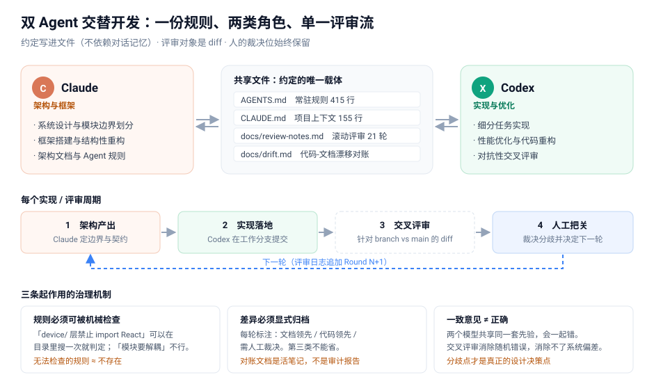
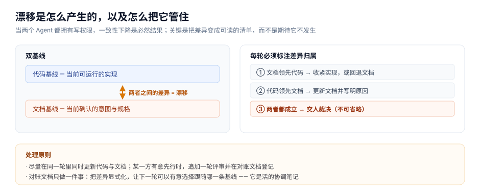

# 双 Agent 交替开发：规则文件、滚动评审与漂移治理

我在一个多模块前端项目（六个职责分层的模块）里用 Claude 与 Codex 交替开发了一段时间，两个模型都对仓库有写权限。这篇文章记录这套流程最终稳定下来的形态，以及过程中暴露的问题。所有引用的规则和日志格式都来自真实使用记录。



## 1. 为什么要两个 Agent

单 Agent 模式跑了几周后，三种缺陷才显性化：

1. **生成与检查共用同一上下文。** 同一个模型先设计再实现，实现里所有妥协之处它都能给出自洽的解释——因为解释和设计出自同一套推理。
2. **缺少对抗性检查。** 所有检查都是"自查"，能发现笔误，发现不了设计层面的偏差。
3. **架构被实现反向带偏。** 实现遇到阻力时，同一个模型会顺手放宽边界，因为它上下文里更紧迫的目标是进度。几轮之后架构文档和代码就不对应了。

共同根源是一个 Agent 只提供一个视角。解法是引入第二个模型，并且——关键的一步——**用文件而不是对话来传递约定**，对话上下文会随会话结束消失，文件不会。

## 2. 两份规则文件，而不是一份

| 文件 | 适用对象 | 内容 | 规模 |
|---|---|---|---|
| `AGENTS.md` | 所有 Agent、所有会话 | 常驻约束：架构隔离、禁止事项、评审流程 | 415 行 |
| `CLAUDE.md` | Claude Code | 项目上下文：技术栈、关键文件索引、必读清单 | 155 行 |

拆分理由是变更成本：一个是共同约束，一个是单个工具的上下文，合并后调整任何一方的上下文都要动大家都依赖的文件。

这套流程里我认为最有用的一条经验是：**规则要能被机械检查。**

无效的规则长这样：代码要优雅、模块要解耦——没有判定标准，Agent 可以声称自己满足了，你也没法反驳。实际生效的规则是这种形式：

```markdown
## 9a. Architecture Isolation Rules
1. `device/` 不允许 import React。
2. `runtime/` 不允许 import React 或 Zustand。
3. `types/` 不允许 import 任何东西。
```

第 1 条在目录里搜一次 `from 'react'` 就能判定；"模块要解耦"永远无法判断。**在有 Agent 参与的项目里，一条无法被机械检查的规则，实际约束力接近于零**——Agent 很擅长在"看起来符合"和"确实符合"之间模糊过去，而人不会逐行核对。

## 3. 单文件滚动评审日志

评审记录最终累积 21 轮，全部放在同一个文件里。轮次格式是强制的：

```markdown
# Review Round N — <标题>
## Context                      # 这一轮在做什么、为什么
## Critical correctness issues  # 协议不匹配、崩溃、不安全解析
## Design/spec deviations       # 与规格或架构文档的偏离
## Architecture risks           # 紧耦合、抽象边界、扩展性
## Suggested next-step fixes    # 按优先级排列的修复
## Deferred items               # 明确推迟的事项（必须填）
```

固定格式解决一个具体问题：没有约束时评审输出会变成散文，下一轮的执行方读不进去。`Deferred items` 强制填写，是把"暂时不做"显式记录下来——技术债通常就是这样丢的：没人记得当初为什么没做。

单文件而非每轮一个文件，原因在 Agent 的读取行为：**它把提供的所有材料平等对待。** 目录里有 21 个轮次文件时，第 3 轮已废弃的设计会被当成当前依据。所以文件顶部维护摘要区（当前状态 / 已定决策 / 未决问题 / 推迟项），历史轮次被明确降级：

> 以下章节只作为历史记录保留，不是第一真相源。

## 4. 评审对象是 diff，输出要先规范化

两条从踩坑里来的约束：

**评审针对 branch vs main 的 diff，不针对代码快照。** 早期直接在主干上改再让 Codex 评审，它没有评审对象，只能泛泛而谈。改成每个周期开工作分支后，评审才有靶子，输出也能逐条对应到具体修改。

**原始评审输出不是实施输入。** AI 评审输出里有大量"可以考虑"级别的噪音，执行方直接消费会去改一堆不重要的问题。中间必须有一道规范化工序：压缩成"改什么、改哪个文件、验收标准是什么"。

## 5. 真正的难点：双基线漂移

真正让我三次修改工作流定义的是漂移。早期是单向流水线（Claude 写码、Codex 评审、人定方向），但 Codex 评审时发现文档与代码不一致却没有修改权，只能等；Claude 实现时发现设计不成立，同样只能等。第 7 轮改成了双向：

> Claude 和 Codex **都**修改代码、**都**修改文档，工作在同一套共享文档上。仓库中可能暂时存在两条活跃基线：可运行代码基线，与文档意图基线。

效率明显提升，但同一轮记录里也写下了风险：**两个 Agent 都能改代码和文档时，漂移会变得更容易。** 自由度上去，一致性就下来——这是整套流程最核心的权衡。



治理靠两件事。一是从第 7 轮起每轮标注差异归属：文档领先代码 / 代码领先文档 / **两者都成立需人裁决**。第三类必须保留——有些分歧不是对错问题，显式标记出来比让 Agent 自行判断安全得多。二是单独的漂移对账文档，它的定位说明比内容更重要：

> 这个文件的目的不是判断哪一方自动正确，而是把差异显式化，让下一轮可以有意选择跟随哪一条基线。

## 6. 过程中暴露的四个问题

- **规范文件自己成了最不规范的文件。** `AGENTS.md` 后期出现 §19/§20 与 §15/§16 内容基本重复——追加规则时没人对照已有条款，Agent 也不会主动指出重复。规范文件的去重必须显式安排。
- **过期条款没有清理。** 第 4 节要求"Mock mode 必须始终可运行"，但该功能后来被整体删除。于是 415 行常驻文件里躺着一条要求 Agent 维护已删功能的规则——比代码-文档不一致更隐蔽的是**指令与现实的漂移**。应对：规则加时间戳与失效条件。
- **评审轮次编号撞车。** 中途重置编号导致 Round 3 出现两次。结论：编号启用后不复用，重新开始时换命名空间。
- **两个 Agent 的一致意见不等于正确。** 有一次双方都认可某个设计，采纳后发现不满足需求——两个模型共享同样的先验，会一起错。**交叉评审消除随机性错误，消除不了系统性偏差**；一致意见可快速通过，分歧点才是真正的设计决策点。

## 7. 可以照搬的最小版本

不需要一上来写 415 行。最小可用版本三个文件：

```
AGENTS.md          # 常驻规则（从 20 行开始）
docs/handoff.md    # 滚动交接日志（当前状态 / 已定决策 / 待办）
docs/drift.md      # 漂移对账（只在出现分歧时写）
```

## 小结

1. 规则要能被机械检查，否则等于没有规则。
2. 评审要针对 diff，否则退化成泛泛而谈。
3. 双 Agent 都有写权限时，漂移是必然的，只能靠每轮记录状态来管。
4. 人的裁决位必须保留——不是模型能力不足，而是它们会以相同的方式出错。

---

*本文讨论个人开发工作方法，不涉及任何组织或业务信息。*
