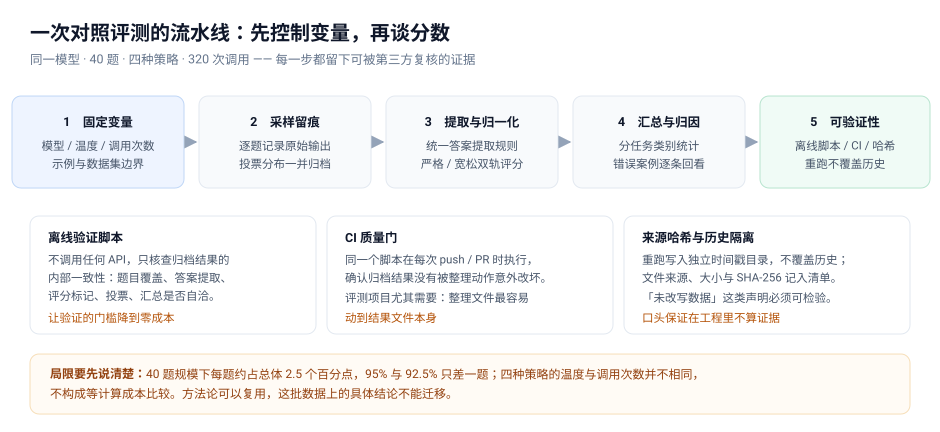
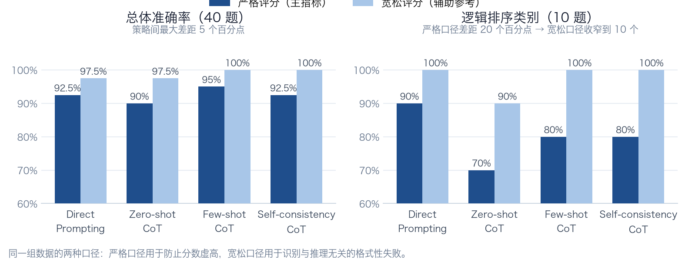

# 提示策略对照评测的复盘：变量控制、双轨评分与可验证性设计

做 LLM 应用时我遇到一个具体问题：改了提示词之后，无法回答"这次改动让系统变好了还是变差了"。没有对照基线，每次调整只能凭感觉归因——效果好归功于改动，效果差归咎于模型。

所以我用整个课程项目把评测流程完整做了一遍：同一模型（Kimi-K2.5）、40 道推理题、四种提示策略、320 次调用，全程留痕。



先给结果，再说这套流程在工程上是怎么组织的、哪些地方做得不够。

| 提示策略 | 做法 | 严格准确率 | 宽松准确率 | API 调用 |
|---|---|---:|---:|---:|
| Direct Prompting | 直接给答案 | 92.5%（37/40） | 97.5% | 40 |
| Zero-shot CoT | 要求逐步推理 | 90.0%（36/40） | 97.5% | 40 |
| Few-shot CoT | 先给三个已解示例 | 95.0%（38/40） | 100.0% | 40 |
| Self-consistency CoT | 五次推理投票 | 92.5%（37/40） | 100.0% | 200 |



这篇文章不讨论"哪种提示策略更好"——40 题撑不起这种结论，后面会专门讲为什么。

## 1. 先解决"对比是否成立"

评测最常见的错误不是算错分，而是变量没控制住、对比本身不成立。跑数据之前先固定：同一模型与接口、40 题四类别各 10 题；Direct / Zero-shot / Few-shot 用温度 0.0 单次贪心解码；Self-consistency 用 Zero-shot CoT 提示、温度 0.7、每题五次采样投票。

四类任务有意选得分散：算术应用题偏数值计算，末字母拼接与字母计数是字符串操作，逻辑排序是顺序关系推理——只有任务类型足够散，才能判断某策略是"只对某一类有效"还是"整体有效"。

有一个必须主动说明的口径问题：**四种策略的温度和调用次数并不相同。** Self-consistency 付出了五倍调用，不是等计算成本比较——如果在同等预算下比，它应该被允许跑五次取最好。这一点写进了报告。评测报告不主动说明自身口径，审阅者的结论会是"作者没意识到"，而不是"作者有意选择"。

## 2. 双轨评分：格式性失败不等于推理失败

答案提取规则必须具体：优先取最后一个 `Final answer:` 之后的内容，没有则取最后一个非空行，再清理标点。因为模型输出格式不稳定，同一道题可能输出 `30`、`Final answer: 30` 或 `30 dollars`——没有统一规则，评分会混入大量与推理能力无关的假失败。

归一化做了两套：**严格**（转小写、合并空白、去末尾句号）作主指标；**宽松**（额外处理单位、答案前缀、括号说明与特定冠词）作辅助参考。一个真实案例：余额题标准答案 `30`，Few-shot 输出 `30`，Direct 输出 `30 dollars`——严格口径下 Direct 判错，这不是推理失败。

但宽松规则不做成万能兜底，边界写死：它处理格式差异，不处理语义差异（`The museum opens first` 不会被自动改成 `museum`）。这条线划清楚，就不会出现"为了让结果好看而放宽标准"。

## 3. 分项结果推翻了总体结论

总体只差 5 个百分点，拆到类别差异大得多：逻辑排序 70%–90%，其余基本持平。初看结论是"CoT 在逻辑排序上反而更差"。

但这个结论要先排除评分口径的影响。逻辑排序的答案是短语（`blue book`、`the table`），模型经常输出带冠词或补充说明的形式，严格评分全部判错。逐条核对后发现：**这一类严格口径下共判错 8 次，其中 7 次差异只在冠词或括号**：

```
gold = 'blue book'    pred = 'the blue book'
gold = 'museum'       pred = 'the museum'
gold = 'the table'    pred = 'the table (and the lamp)'
```

宽松口径下这 7 处全部判对，只剩 1 处真实错误。所以更准确的表述是：**逻辑排序的严格口径差距主要来自答案表述差异，不是推理能力差异；排除格式影响后，四种策略收窄到 90%–100%。**"CoT 在逻辑排序更差"很大程度上是评分口径造成的假象。

这也是双轨评分必须同时看的原因：严格口径防止分数虚高，宽松口径识别哪些失败与推理无关——只看其中一个都会得到错误结论。

关于多数投票还有一个反例：逻辑排序上 Self-consistency 的五次采样大多高度集中（10 题里 7 题 5/5 一致），但**集中不等于正确**——有一题五次回答完全一致，答案仍然是错的。而真正分票的三题，分票原因基本是表述差异而非推理分歧。多数投票能抑制随机性误差，抑制不了系统性偏差：五次采样共享同一套先验时会一起错。

## 4. 三处标签修正

评测进行到一半发现数据集本身的错误：三道末字母拼接题的标准答案标错了（如 `pak` 应为 `plk`）。不修正的话模型答对也会被判错。

处理方式是把修正前后的完整差异单独存档留痕，而不是直接改掉，并在报告中说明修正经过确认。修改评测集是可以被用来美化结果的动作，唯一可行的自证方式是把改动过程完整留痕，让别人能自己判断是否合理。

修正后末字母拼接四策略全部 100%——反而暴露这批题难度不足、没有区分度，属于失效评测题。

## 5. 可验证性设计

评测如果别人无法验证，结论价值就有限。三个成本不高的设计：

**离线验证脚本，不需要 API Key。** 不调用任何 API，只核查归档结果的内部一致性：文件哈希、题目覆盖、答案提取、评分标记、投票与汇总是否自洽。解决的实际问题是：别人不会为了验证你的结论去申请 Key 自费重跑，应该让他们只需检查数据处理逻辑。

**CI 质量门。** 同一个脚本在每次 push 和 PR 时由 GitHub Actions 执行，确认归档结果没有被整理动作意外改坏——评测项目里整理文件最容易动到结果文件本身。

**重跑不覆盖，来源可核对。** 重跑写入独立时间戳目录；文件来源、大小与 SHA-256 记入清单。"整理时未改写任何数据"这类声明需要可检验，所以才有哈希清单——口头保证在工程里不算证据。

另外，320 次请求的实验中断很常见，脚本支持断点续跑（`RERUN_FAILED_ONLY=1`），配合限流退避。任何会产生费用的长任务，都应先设计好失败后如何继续。

## 6. 局限性与重做清单

40 题规模下，每题对应总体准确率 2.5 个百分点、分项 10 个百分点；没有显著性检验，95% 与 92.5% 只差一题；策略间温度与调用次数不同，不构成等成本比较；依赖锁文件与随机种子未完整记录。

**方法论可以复用，这批数据上的具体结论不能迁移。** 如果重做，按优先级：样本扩到 200 题以上并做显著性检验；为 Self-consistency 设等成本对照组；剔除或加难没有区分度的类别；固定随机种子；把成本作为一等指标（准确率除以调用次数）——最后这个才是工程决策真正需要的口径。

## 小结

1. 评测的第一道关是控制变量，不是算分。变量没控制住，数字越精确越误导。
2. 让结论可被验证。离线脚本、CI、哈希清单成本都不高，但能把结论从"我说的"变成"你能查的"。
3. 主动写下局限性。没写清楚的弱点审阅者一定会发现；自己写清楚是严谨，被指出来是硬伤。

---

*本文是个人课程项目的工程复盘，数据集来自课程材料，不涉及任何组织或业务信息。*
