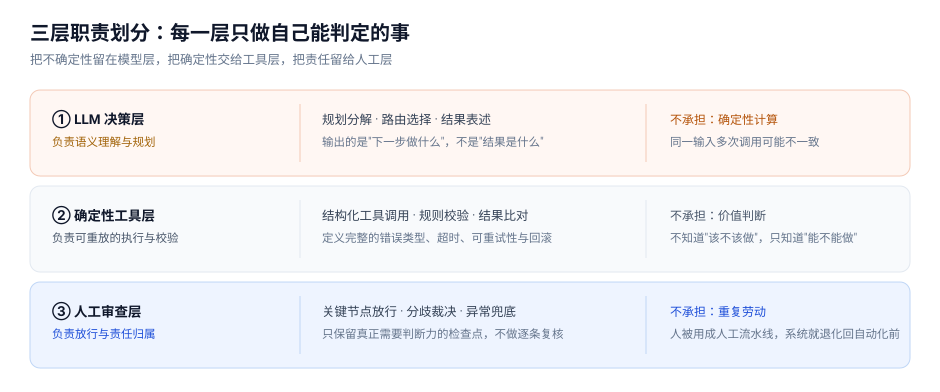
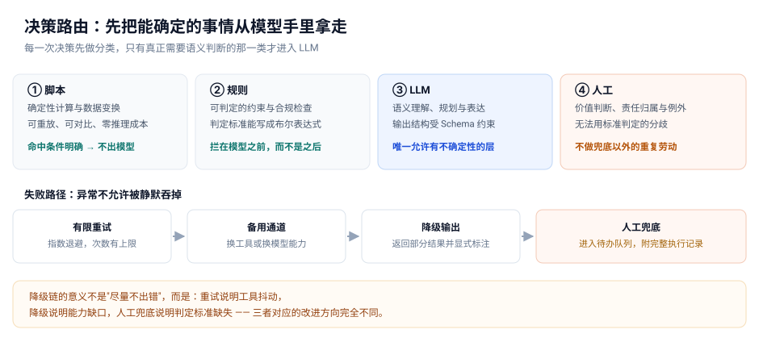
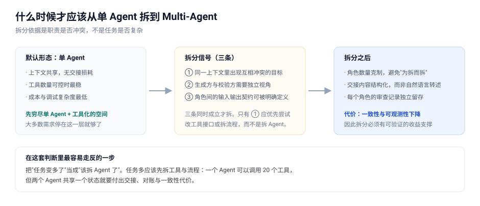

# 受约束的 Agentic Workflow：让 LLM 进入严肃工程流程的可靠性设计

大多数 Agent 项目失败的原因不在模型能力，而在目标设定。Demo 阶段的默认目标是"让 Agent 尽可能自主"；进入生产环境后，命题变成：**在结果必须可追溯、可签核的流程里，如何让 LLM 参与进来而不引入不可控风险？**

这两个目标的设计取向是相反的：

| 取向 | 自主优先 | 可靠优先 |
|---|---|---|
| 关键动作由谁执行 | LLM 直接生成 | 确定性工具执行 |
| 错误的处理方式 | 让模型自我纠正 | 有限重试 → 降级 → 人工 |
| 成功的标准 | 任务完成 | 任务完成**且**可追溯、可复现 |
| 人的角色 | 兜底 | 关键节点的强制审查位 |

本文整理的是后一种取向下的设计方法，来自一段真实工程实践的抽象，举例均已替换为中性场景。

## 1. 三层职责划分

整套框架的地基是把系统分成三层，每一层只做自己能判定的事：

划分的逻辑是**把不确定性圈在模型层**：LLM 输出的是"下一步做什么"，不是"结果是什么"；真正的结果由确定性工具产出，天然可重放；人只保留需要判断力的检查点。反过来的设计——让 LLM 直接生成关键产出物、人逐条复核——人很快就被用成人工流水线，系统退化回自动化之前。

## 2. 决策路由：先把能确定的事从模型手里拿走

不要一上来就设计 Agent，先分解流程。把流程拆成节点后，每个节点归入四类路由：

这个分类的额外好处：**它把"该不该用 LLM"的争论，变成逐节点填表的机械动作。** 判断标准一句话：能被精确描述的动作，就不该交给 LLM。

工具接口的质量决定这套路由的上限。一个工具除了输入输出，必须定义**错误类型**、超时策略、可重试性与回滚方式——其中错误类型最容易被忽略。不要把几千行原始日志扔给模型，要返回带 `error_class` 的结构化结果：**工具的输出格式，实际上决定了 Agent 的决策精度。**

失败路径必须在设计期确定，写成逐级降级链：有限重试 → 备用通道 → 降级输出 → 人工兜底。降级不是妥协而是设计决策——一个明确"只能降级到静态检查"的系统，比"无限重试直到崩掉"的系统可靠得多。

## 3. Trace 与分层归因

每次执行记录完整链路：输入与版本、执行计划、工具调用与输出摘要、状态转移、重试次数、校验结果、人工决策。事件分三类：**模型判断 / 工具调用 / 关键节点**。

结果异常时不要笼统说"模型能力不行"，归因要到具体一层：

| 归因层 | 典型症状 |
|---|---|
| 模型推理 | 计划本身不合理，分解粒度错误 |
| 上下文注入 | 关键信息没传进去，或传了过期版本 |
| 工具实现 | 接口有 bug，返回值不符合契约 |
| 下游依赖 | 外部系统超时、返回格式变更 |

**能定位到是哪一层坏了，是运维效率的分水岭。** 健康度除了成功率，还要盯平均执行步数和成本这两个非百分比指标——成功率没降但步数翻倍，通常意味着系统正在靠重试掩盖某个缺陷。

## 4. 评估：人工接受率比成功率可信

评估体系三件事：黄金集回归（任何变更后先跑固定样本，防静默退化）、量化指标看板、人工接受率统计。

最后一条值得展开：**"生成成功率"是可以被优化的数字，"人工接受率"不能。** 系统可以把产出做得越来越完整，但如果工程师每次都要大改，系统的实际价值是负的。所以要同时统计生成成功率、人工接受率、人工修改率、升级到人工的比例——四个指标的组合才反映真实可用性。

同理，Prompt、工具、模板、模型的任何改动都应触发回归。**大多数 Agent 系统的崩溃方式不是突然失败，而是在一次次小改动中悄悄退化。**

## 5. 什么时候才该拆 Multi-Agent

默认形态是单 Agent + 工具闭环：更好控制、更好审计、更好评估。只有出现客观的职责冲突信号才考虑拆分：

拆分时的纪律：沿用同一套工具层与 Trace 机制（不要每个角色各建一套）；交接内容结构化而非自然语言转述；引入审查角色时要能验证"审查是否真的发现了问题"，而不是走过场。

## 6. 明确不下什么结论

一份可信的设计文档要说明自己**没有**得出哪些结论。这套框架只覆盖设计原则与机制，不对生成成功率、质量提升幅度、效率节省比例下任何量化结论——这些必须靠模块级与端到端实验验证。

把未验证的部分显式列出来，恰恰是方法论可信度的来源。**一个把所有指标都报得很好看的方案，通常意味着它还没进过真实生产环境。**

## 小结

1. 可靠性不是模型问题，是系统问题：约束、路由、降级、归因都是在模型之外设计的。
2. 能被精确描述的动作不交给 LLM；失败路径在设计期确定，不在故障期即兴。
3. Multi-Agent 解决的是职责冲突，不是任务复杂度。

---

*本文为个人方法论沉淀，已去除全部组织、业务与内部工具信息，举例均为中性场景。*
